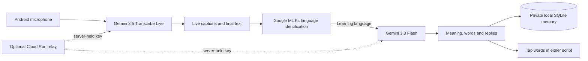

# LingoLive

[Detailed technical PDF](docs/submission/LingoLive-Writeup.pdf) · [Full write-up and hackathon package](docs/submission/WRITEUP.md) · [Prepared entry](docs/submission/ENTRY.md)

## Current source: web 1.9 — Plan ahead and find your words

**My plan → Before you go** saves your intention before leaving home, with optional
steps such as cab → tea stop → railway station. Save makes no AI request. The plan
survives new conversations and reloads for a day; you control done/skip/previous.

Speech in your familiar language can now become **Say it in Kannada** (or your
selected learning language), with meaning, pronunciation and playback. Heard
Kannada still produces next-turn replies. **Help me say this** explicitly requests
phrasing for an existing utterance.


Saved places now have geographic return checks: opt-in, max five places and three
notes per place; only two notes can join context when you return nearby. Fresh,
accurate stationary location is required; saved area coordinates remain local.

Useful activities and preferences carry across conversations in
each local learner profile. The existing source AI call proposes grounded memories;
inferred items stay **possible** until confirmed. Settings → **What LingoLive
remembers** lets you edit, add, confirm or forget them. No GPS trails, extra model
call or model-weight fine-tuning. See [memory design](MEMORY.md).

[Watch the current demonstration](https://storage.googleapis.com/lingolive-demo-358650584819/ai-builder-cup-2026/v2.1/index.html) · [Download MP4](https://storage.googleapis.com/lingolive-demo-358650584819/ai-builder-cup-2026/v2.1/LingoLive-Demo-download.mp4)

The corrected Bengaluru/Kannada demonstration is now rendered: **2:22**,
with clear Google Gemini TTS dialogue, no artificial noise bed, actual app responses, a visible speech correction
and learning introduced near the end as an extra. See [video provenance](docs/submission/DEMO-V2.md).

LingoLive helps newcomers, interstate migrants and immigrants handle everyday
conversations in a language they are still learning. A newcomer to Bengaluru can
use Kannada replies for a commute or a tea order, then study those words later.

**Conversation** shows what was said, its translation and three useful replies.
Original-script/pronunciation switching, playback and copy help the learner say
something immediately. Word-meaning buttons and teaching explanations are kept
out of this live view. **Saved** opens a separate review with tappable source and
reply words, meanings, pronunciation and practice. Opening a review, switching
its script or tapping a word makes no extra AI request and works offline with
saved data. The prepared Kannada review is labelled and creates no fake history.

The existing Google pipeline remains **Gemini 3.5 Transcribe Live** plus two
parallel **Gemini 3.1 Flash-Lite** requests with minimal thinking. Both branches
still prepare and validate the full compatible lesson data; the UI surfaces
teaching later without another paid call. Authentication, model/audio quotas and
cost guards stay in force. The three-step tutorial now introduces live replies
before later learning, with a Kannada illustration.

The prior web 1.5 complete-lesson benchmark averaged **1.79 seconds** over ten
warm-path requests, with zero failures. It is historical backend evidence, not a
new 1.6 mobile/network/cold-start guarantee. See [the comparison](docs/LATENCY.md).
Deployment uses the normal refreshable Cloud SDK login; no deployment credential
is included in this repository.

The [Bengaluru/Kannada transcript](docs/submission/DEMO-TRANSCRIPT-V2.md) was
approved before production. The final video includes synthetic speech,
a generated opening illustration and explicitly simulated location/time. Real
Google APIs handle the app demonstrations. The earlier 2:53 video remains archived.

Connect with **Use access code** to use your host's Google allowance, or
**Use my Google API key** to use your own Google AI Studio account for both
transcription and replies. Personal-key mode never falls back to the host's key
or Cloud Run service account. Google bills that key's project; this service still
relays requests and applies infrastructure limits. Saved learning stays local.

Keys are sent to the relay over HTTPS and held in server memory for up to one
hour, not in browser storage, lessons, cookies or a server database. Disconnect
revokes the session and stops its live streams. A service restart forgets keys
and requires reconnecting. Google checks key validity/model access on use;
opening a session alone does not verify Google access. Restricted keys must allow
these server-side Gemini API calls; browser-referrer-only keys are unsuitable.

The live screen shows heard speech and three suggested replies. Word meanings
open in a tap bubble when reviewing a conversation in Saved. Goals are optional; replies use recent conversation, earlier
suggestions and this learner's local memory. The gear opens profile, goal, place
and optional location/sound controls. See [MEMORY.md](MEMORY.md).

**Deployment status:** the current verified revision is recorded in
`validation/cloud-current-deployment.json`. A real Google audio-to-context-lesson
check passed on 1.5; the new reply-first UI is verified separately.
valid personal-key inference and physical-phone capture remain unverified.
Live latency measurements (10 successful lessons) and reproduction instructions
are in [docs/LATENCY.md](docs/LATENCY.md).
The Android binary is unchanged; its existing direct-key option remains separate. The independent GitHub repository is
[U4AR/LingoLive](https://github.com/U4AR/LingoLive). Credentials, local environment
files, signing keys and generated APK/ZIP files are excluded from Git.

A web and Android companion for learning from real conversations. Choose a language
you know and a language you are learning, then tap **Start listening**. Google's
**Gemini 3.5 Transcribe Live** transcribes speech across languages, including
code-switching. Web 1.7 final learning-language phrases become short **Gemini 3.1 Flash-Lite**
lessons: what was said, what each word means, a usage note, and three natural replies.

In Saved, tap any word in the source or a suggested reply for its contextual meaning,
pronunciation and usage. Switch between original script and pronunciation text.
Hear a reply with the phone's text-to-speech voice or copy its original text.
Transcripts, lessons, reply vocabulary and word meanings are saved locally (IndexedDB in the browser; SQLite on Android) and can be searched, reopened or deleted. No audio recordings are
saved by this application.

This is an independent project. It installs alongside Bible Audio and VerseKeep.
It does not use their models, corpus, API keys or application storage.

## Host access: private access code

Google sign-in and an explicit invited-email allowlist are implemented and tested
and included in live revision the current verified revision. Host-funded access still
requires the private access code; **Google sign-in is not active there yet**.
The user chose simple private-access-code sign-in. No Google OAuth registration
is needed for either the selected host-code flow or personal-key mode. Optional Google account support remains
disabled; see `WEB-DEPLOY.md` only if choosing to enable it in future.

When enabled, Google sign-in AND the private code are required. Old cookies and
Android access-code-only bearer calls are rejected. The existing Android APK
has no Google account UI and cannot access a Google-required deployment until
its sign-in flow is updated. Public example and local saved lessons remain usable.
Google Identity Services loads from Google only for the sign-in screen; regular
web operation still needs no frontend build or framework.

## Web app

A responsive browser version is included in `web/` and served by the same FastAPI
service as the Google relay. **One Cloud Run deployment serves the website, live
WebSocket transcription, and Flash lessons from one HTTPS origin.** No Node build,
CDN, third-party font or frontend runtime dependency is required. The Android app
remains available as a companion; its existing bearer-token API is unchanged.

Open the deployed service URL, choose the language you understand and the language
you are learning, click **Connect**, and enter your host's private access code
(`LINGOLIVE_ACCESS_TOKEN`), or select **Use my Google API key**. The recommended Cloud Run host deployment uses Vertex AI and the runtime service account,
with no Google API key. The optional Gemini API provider keeps its key in Secret
Manager; it is never returned to the browser. A one-hour signed HttpOnly, SameSite=Strict,
Secure cookie authenticates browser requests and WebSockets. Cookie writes and
WebSocket upgrades require the application's own Origin. Localhost development
uses a non-Secure cookie; public deployments require HTTPS.

Use the large **Start listening** button, or type/paste a phrase. The browser sends
mono 16 kHz signed 16-bit PCM, using an AudioWorklet that resamples the device's
actual audio rate. Google Transcribe Live supplies all-language captions. Interim
text is temporary; finalized phrases are retained. **Unlike Android's local ML Kit
check, the browser uses Flash itself to check each final phrase for the learning
language.** Only matching phrases become word-by-word lessons and three replies;
other speech remains a transcript. This uses two parallel Flash-Lite requests per finalized phrase, with a 20-phrase
pending queue. Each lesson reserves two model-call units; existing allowances
permit at most 12 lessons/minute, 180/hour and 200/day in parallel mode. The browser
does not add an artificial delay between completed lessons.

During a conversation, use the reply pronunciation, playback and copy controls.
Afterwards, open **Saved** to tap words, switch reading modes, practise replies,
search, revisit or delete your history. Phrases, explanations
and vocabulary are stored in **IndexedDB on this browser**, not the server. The
prepared Japanese example is clearly labeled and never saved as captured speech.
The public application shell is cached for offline reload and saved-lesson access;
API responses, credentials and audio are never cached by the service worker.
Clearing site data removes history. Private browsing, blocked storage or quota
exhaustion may prevent persistence; the interface reports storage failures.

Capture stops when you press Stop, switch to Saved, open Connection, play a reply,
background the page, or lose connectivity. Stop allows up to 4.5 seconds for final
transcription. Sessions renew at 9.5 minutes with at most five seconds of queued
PCM; slow/disconnected streams pause visibly. New listening and lessons require
network access and Google model quota. Browser pronunciation depends on available
system voices. This version has been exercised in desktop Chromium and a mobile
viewport; physical iOS/Safari and Android browser capture remain unverified. Hosted
Google transcription and a multimodal context lesson passed with synthesized
audio; this does not establish real-world language or speaker accuracy.

Run the actual web service locally (the example and shell need no Google key):

```bash
backend/.venv/bin/python -m uvicorn backend.app:app --host 127.0.0.1 --port 8093 --no-access-log
```

For Cloud Run set `LINGOLIVE_PROVIDER=vertex`, `LINGOLIVE_VERTEX_PROJECT`, and a
random `LINGOLIVE_ACCESS_TOKEN` of at least 32 characters. The runtime service
account obtains OAuth credentials automatically and needs model-prediction/service-
usage permissions. No Google API key is required. For local development, valid
Application Default Credentials are needed for Vertex, or use the optional
`LINGOLIVE_PROVIDER=gemini` with `GEMINI_API_KEY`. Never put credentials in `web/`,
frontend build arguments or source control. Deployment outputs the HTTPS address.

Browser regression checks run against an explicit local-only fixture:

```bash
node tools/test_web_core.mjs
backend/.venv/bin/python -m unittest discover -s backend/tests -v
# Separate terminal, from this project directory:
backend/.venv/bin/python -m uvicorn tools.web_fixture:app --host 127.0.0.1 --port 8094 --no-access-log
# Requires Playwright and a local Chromium installation (test tooling only):
node tools/test_web_browser.cjs
```

`tools/web_fixture.py` is a test server with synthetic responses and a test-only
access code. It is excluded from the production image and must never be deployed.
The production root page works without credentials but does not pretend that the
prepared example proves live Google access. Deployment and live-inference evidence is recorded in `VALIDATION.md` and
`validation/cloud-*`. Building a source ZIP alone does not deploy a new service.

## Install and connect

Install `LingoLive.apk` on Android 8/API 26 or newer. It is a universal APK with
the Google ML Kit language-identification model included. Internet is needed for
Google transcription and new lessons; saved learning works offline. A microphone
permission is requested when listening starts. There is no background recorder.

Open **⚙ → Connection** and choose either:

1. **My Google API key**: enter your own [Google AI Studio key](https://aistudio.google.com/apikey).
   The account must have access to Transcribe Live and Flash, with billing/quota
   as required by Google. The key is entered after installation and encrypted at
   rest using Android Keystore. Model IDs can be changed in **Model settings**.
2. **Hosted on Google Cloud**: enter the deployed Cloud Run HTTPS origin and its
   private backend access token. Google authorization stays on the server; the recommended Vertex provider
   uses its service account without a Google API key. Model IDs are server-controlled.

The APK and source contain no working Google key, backend token or server address.
Builds need no API credential. This release is ready for credentials to be added
later; it does not imply that a Google Cloud service has already been deployed.
The clearly marked **Try an example** works without credentials and never inserts
fake speech or lessons into learning history. You can also type/paste a phrase.

## Android listening and learning behavior

- Interim captions update while you speak; only finalized speech is saved or taught.
- Transcribe Live uses automatic language detection (`languageCodes: []`) in
  literal `VERBATIM` mode, preserving filler words and false starts. It transcribes
  all supported speech rather than filtering audio to only the learning language.
- Bundled **Google ML Kit language identification** checks final text on the phone.
  A target-language candidate at confidence ≥0.35 queues a Flash lesson. Flash
  checks whether the learning language is actually present before teaching it.
  Short, ambiguous and mixed-language phrases can be misidentified: **Teach this
  phrase** lets you request a lesson explicitly. There are 83 distinct locale
  choices from Google's current published Transcribe language table.
- The same word data drives original and transliterated text, so both remain
  tappable. Word meanings are already in the saved lesson; opening one makes no
  additional API request. AI glosses and transliterations are contextual estimates.
- A lesson is accepted only if its word pieces reproduce every original character,
  every lexical piece has a meaning and reading, and three replies are complete.
  The original transcript remains available when generation fails or is incomplete.
- Flash requests run sequentially, at most one start every 2.5 seconds (24/minute),
  with at most 20 pending lessons. Overflow is saved for manual retry. Limits or
  network errors never discard completed transcripts. Stop listening stops the
  microphone; previously queued lessons can still finish. Edited/pasted phrases
  make an explicit lesson request without depending on language detection.
- Microphone PCM is mono, 16 kHz, signed 16-bit little-endian, streamed in roughly
  100 ms frames. Google handles voice-activity detection and final utterances.
  Stop sends `audioStreamEnd` and allows 4.5 seconds for the final transcript.
  Opening Saved/Settings, backgrounding, and hearing a reply stop capture.
- Google's live-session limit is ten minutes. The app renews at 9.5 minutes and
  briefly buffers up to five seconds of audio while reconnecting. If the connection
  cannot keep up, it visibly pauses rather than silently dropping buffered speech.
  The last few words can be lost during a network/device failure; completed text
  remains local. No app can recover speech that never reached transcription.
- Pronunciation playback uses installed Android voices. Install the target voice
  in the phone's text-to-speech settings if it is unavailable. Speech pauses before
  playback to prevent the app from transcribing its own voice.

Settings do not pre-fill secrets into visible controls. Blank replacement fields
retain the existing credential; **Remove saved credentials** removes both secrets.
Android backups are disabled. Clearing app data/uninstalling removes local memory
and credentials. The hosted API has no learning-history database.

## Google Cloud Run backend

The backend relays Transcribe Live WebSockets and makes Flash requests. The
recommended Vertex provider uses the Cloud Run service account and Google Cloud
billing. A Google AI Studio API key is optional with `LINGOLIVE_PROVIDER=gemini`. It forwards speech without creating audio files. HTTPS
and a separate bearer token protect the private deployment. All `/v1/` learning endpoints
require authentication; browser sign-in accepts the private access code or a personal key session; `/health` reports service/version/configured and personal-key availability without credentials.
It enforces model-call allowances of 24/minute, 360/hour and 400/day per allowance
group. Parallel lessons consume two units each; host and personal-key groups remain
separate. Two branch token caps together remain at most 4,096 tokens.
Two active audio streams are allowed, with up to two additional connections
draining final text for five seconds during renewal. Audio is limited to 40
combined minutes/hour and 60/day, including idle connection time. Connections
reserve ten minutes before Google is contacted and refund unused time on close.
PCM cannot arrive faster than real time plus five seconds of startup buffering.
There are two concurrent lessons, 1,000 input characters and 4,096 output tokens
per lesson, 12 sign-in/connection starts per minute, and one-hour browser cookies.
`LINGOLIVE_AI_ENABLED=false` pauses both paid routes. Defaults deploy with zero
minimum and one maximum instance and request-based CPU billing. These counters
are in memory and reset on restart/redeploy; they are usage guards, not a hard
billing cap. The shared allowance accommodates two fifteen-minute listeners
with renewal. Cold starts and provider latency still apply. It is suitable for a personal/hackathon demo;
add per-user authentication and quotas before running a public multi-user service.

Prerequisites: a billing-enabled Google Cloud project, the Vertex AI, Run, Cloud
Build, Artifact Registry and Secret Manager APIs, one private-access-code secret,
and dedicated runtime/build service accounts. Give the runtime account only
`aiplatform.endpoints.predict`, `serviceusage.services.use`, and Secret Accessor
on the private-access-code secret. A custom project role can hold the two model
permissions. Give the dedicated build account `roles/run.builder`. The deployment
operator needs the normal Cloud Run source-deployment/build/IAM permissions.
Keep Google keys and the random ≥32-character backend token out of the checkout.

```bash
gcloud services enable run.googleapis.com cloudbuild.googleapis.com \
  artifactregistry.googleapis.com secretmanager.googleapis.com aiplatform.googleapis.com --project YOUR_PROJECT

# Create the private access-code secret and grant the runtime/build roles first.
PROJECT_ID=YOUR_PROJECT \
SERVICE_ACCOUNT=lingolive@YOUR_PROJECT.iam.gserviceaccount.com \
ACCESS_TOKEN_SECRET=lingolive-private-access \
LINGOLIVE_GOOGLE_SIGNIN_REQUIRED=false \
bash tools/deploy_cloud_run.sh
```

The command deploys from the included standard Dockerfile, with a 600-second
request timeout, the Vertex provider, and the private code bound from Secret Manager. The HTTPS address can be reachable publicly while
its application endpoints still require the private access token. Open that HTTPS URL for the web app, or enter its base
origin (no `/v1` suffix) and the token on the phone. No service is deployed by an
APK build. `backend/.env.example` lists runtime bindings; do not commit filled
environment files. Cloud Run and Google model usage can incur charges.

For backend development:

```bash
uv venv backend/.venv
uv pip install --python backend/.venv/bin/python -r backend/requirements.txt
backend/.venv/bin/python -m unittest discover -s backend/tests -v
backend/.venv/bin/python -m uvicorn backend.app:app --host 127.0.0.1 --port 8093 --no-access-log
```

`GET /health` works without credentials and returns `configured:false`; protected
routes then return 503. Actual Google calls require either configured Vertex credentials/project plus the
private code, or the optional Gemini API key plus private code. Tests
use explicit mock providers and do not spend Google quota or prove model access.

## Android build

Use JDK 17+, Android SDK platform/build-tools 36 and Gradle 8.13 (wrapper included).

```bash
bash tools/create_dev_key.sh
cd android
./gradlew :app:testDebugUnitTest :app:assembleDebug :app:assembleRelease \
  :app:assembleDebugAndroidTest
```

The development key is retained privately for update compatibility, excluded from
source archives and version control. Generate your own when building the source;
that creates a different signing identity. Configure your own release signing for
store distribution. The delivered sideload APK is non-debuggable but signed with
this project's development certificate. The release build rejects cleartext;
loopback HTTP is enabled only in the debug variant for test servers.

The Kotlin checks validate language matching, source conservation, Unicode span
mapping, transliteration, protocol events and secure origins. Android checks cover
Keystore persistence, real local ML Kit identification, offline example/word UI,
SQLite memory, retry after 429, and the full app pipeline with explicitly mocked
Transcribe/Flash servers and a test PCM source. The Python suite checks auth,
bounded streaming, server model control, rate limits and the real Google request
contract against mocked HTTP. See `VALIDATION.md` for completed results and limits.

## Design and hackathon demo



For a short demo: choose English/Japanese; connect the key or Cloud Run service;
start listening; speak an offer such as “コーヒーはいかがですか？”; inspect its meaning;
tap a particle; switch to pronunciation; choose a suggested reply; stop listening;
open Saved and find the lesson and vocabulary. The built-in example demonstrates
the same presentation when demonstrating without paid credentials.

The code is prepared for later open sourcing under Apache-2.0. Model/API access
and third-party SDKs have their own terms. No event affiliation or eligibility
claim is made by this project.

API references checked October 16, 2026:
[Transcribe Live](https://ai.google.dev/gemini-api/docs/live-api/live-transcribe),
[Transcribe model](https://ai.google.dev/gemini-api/docs/models/gemini-3.5-transcribe),
[Web Flash-Lite model](https://ai.google.dev/gemini-api/docs/models/gemini-3.1-flash-lite), and
[structured outputs](https://ai.google.dev/gemini-api/docs/structured-output).
