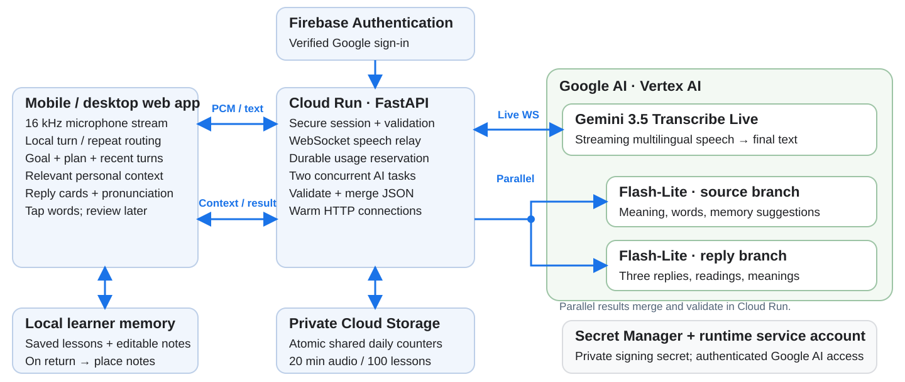

# LingoLive

**Understand. Reply. Keep going.**

**AI Builder Cup 2026 · CreativeEngine**  
**Theme: Sustainability & Social Impact · Category: Accessibility**  
Ashish T. Vasant, team leader · Janhvi Singh, team member

## What LingoLive does

LingoLive is a mobile-friendly conversation assistant for people living, working or travelling in a place whose language they are still learning. It listens to the other person's speech, shows its meaning in the user's familiar language, and offers three short, context-appropriate replies in the local language, with pronunciation and word meanings. The user chooses a reply and speaks it. The immediate goal is to help the person complete the conversation confidently; afterwards, saved exchanges become a personal language-learning library.

A newcomer in Bengaluru hears a cab driver ask a question in Kannada. Their familiar language is English. LingoLive shows the question's meaning and replies that fit the person's actual plan: take a cab to the railway station, with an optional tea stop if time allows. If they instead say what they want in English, the app helps express that intention in Kannada. The same interaction pattern supports a Marathi conversation in Mumbai or a migrant navigating a new language in another country.

Personalization builds from the user's plans, recent conversation, editable activities and preferences, and **memory tied to saved locations**. A tea-order preference saved near a regular café becomes relevant when the person returns nearby. The live interface keeps the heard words and useful replies prominent, with one large microphone control. Pronunciation, individual word meanings and later practice remain available when the user needs them.

**Live prototype:** https://lingolive-358650584819.us-central1.run.app  
**Public source:** https://github.com/U4AR/LingoLive

## The accessibility problem

Understanding a translated sentence is only one part of participating in an unfamiliar-language conversation. A newcomer must also decide what to say, express it politely, pronounce it and keep track of the task while the other person waits. Transport, shopping, workplace introductions and routine services create repeated moments in which a language barrier reduces independence. A generic reply can also be inappropriate when the assistant misses the user's destination, an earlier answer or a local routine.

LingoLive supports the whole next turn: understand the question, select a useful response and say it. Plans prepared before the encounter and relevant memories reduce repeated explanation. The person remains in control of what is said, which speaker is being interpreted, and what is remembered. This aligns the project with **Accessibility** within the **Sustainability & Social Impact** theme: practical access to everyday communication and community participation.

## Users, customers and adoption model

End users include interstate migrants, international immigrants, newcomers joining a workplace or university, family members relocating with them, and people travelling through an unfamiliar-language region. The product's customer base can include migrant groups and community associations anywhere, newcomer-support organizations, NGOs, universities, employers and relocation services. These organizations can sponsor access and introduce language pairs relevant to their communities.

**Illustrative adoption estimate:** 20 community, campus or employer partners supporting 100 learners each would provide a path to 2,000 learners. This is a bottom-up expansion scenario: one partner introduces the app, helps participants choose their languages, and sponsors a predictable usage allowance. The initial product demonstration uses Bengaluru and Kannada; the customer model applies across regions and language communities.

**Proposed delivery model:** community and organization-sponsored usage packages, sized around an estimated **US$5 per active learner per month** for ten listening minutes on 20 days each month. A 100-person group shares hosting overhead while each learner retains their own local plans and memories. Community grants, institutional partnerships and personal-key access provide additional distribution options. Partner packages can add onboarding and support around this estimated operating budget.

## A complete user journey

**Before leaving:** the user selects familiar and learning languages and can type a general intention: “Take a cab to the railway station; stop for tea first if there is time.” The app keeps a short plan with ordered steps and optional stops. Done, Skip and Previous controls let the user explicitly advance it. A blank goal is supported: recent speech and the ongoing scene help infer useful replies.

**During the conversation:** the microphone streams speech to Google's live transcription service. The app detects the language and routes the turn. Other-person speech produces a meaning and three short replies. Familiar-language speech can become a request to express the user's intention in the learning language. Reply cards support original script, pronunciation, playback and tappable word meanings. The user can correct who spoke in one tap.

**When the learner reads a reply:** forgiving text matching and short-lived voice estimates identify full or substantial partial readbacks. The actual words join the learner's conversation context, and the existing reply options stay available. The next other-person utterance uses that history to generate the next set of relevant replies. This keeps the conversation moving and reduces duplicate AI work.

**On a later visit:** with explicit place-memory permission, a fresh stationary return near a saved location recalls a small number of relevant notes. At a regular tea stop, “usually orders ginger tea to take away” can help shape the reply. At a different place, its notes are withheld. Current speech and explicit plans take priority over remembered preferences.

**Afterwards:** Saved provides the original conversation, meanings and pronunciation for review. The learner can revisit vocabulary from a real encounter rather than interrupting the live conversation for a lesson. Personal notes and memories can be confirmed, edited, paused or forgotten.

## Deployed architecture

The responsive web app captures 16 kHz mono PCM audio through an AudioWorklet and sends it over an authenticated WebSocket to a FastAPI service on Cloud Run. That service relays audio to **Gemini 3.5 Transcribe Live**. Partial transcription provides live feedback; committed text supplies the conversation turn. Local routing checks recent suggestions and session voice estimates before a new generation request is scheduled.

For a turn needing assistance, Cloud Run starts **two Gemini 3.1 Flash-Lite requests concurrently**. The source branch produces the translation, contextual word meanings, readings and grounded memory proposals. The reply branch produces three usable replies with readings and meanings. Both receive the same bounded snapshot of the user's goal, active plan, recent turns, relevant general memory and matched-place notes. Cloud Run validates the structured results, restores exact source spacing and merges the two branches into one response.

The live service uses Vertex AI through its runtime service account. Firebase Authentication provides Google sign-in, and Secret Manager holds the private session-signing secret. A private Cloud Storage object implements durable shared daily usage counters. In the browser, IndexedDB stores saved lessons and LocalStorage keeps local learner profiles, settings, plans and editable memories. This separation keeps the interaction fast while persisting the small usage state needed to protect the hosted prototype.

## Memory that follows the person and the place

The system separates short-lived conversation context, personal facts, task intentions and geographically linked notes. Each layer has a clear relevance window and storage bound. This keeps prompts concise and avoids carrying every past exchange into every request.

| Memory layer | Stored information | Retrieval and lifetime |
| --- | --- | --- |
| Current conversation | Recent words, speaker role, prior replies and compact scene context | Up to eight turns and twelve seen words; expires after 90 minutes of inactivity |
| Before-task plan | General intention, up to six ordered steps, optional stops and current progress | Active plan joins both AI branches; one-day persistence |
| General learner memory | Activities, routines and preferences with exact learner evidence and confirmation state | Up to 60 items per profile; up to five relevant items per request |
| Location-linked memory | Rounded saved area, place label and short useful notes | Up to five places, three notes per place and two recalled notes per request |
| Saved learning | Conversation text, contextual meanings, replies and pronunciation | Local review library, selected by the user |

**Grounded personal memory:** the source branch can propose at most two brief facts from the learner's current words. The browser checks speaker attribution and exact supporting evidence. Possible memories remain editable, and explicit confirmation improves their status. One-off plans expire after a day, possible routines after 30 days and confirmed general facts after 180 days. Current instructions and speech outrank older memories.

**Location-linked saving:** the user enables saved-place memory. Foreground location samples establish a stationary stay before a note can be attached to a rounded area. A grounded AI proposal can add a place fact through the same source response; the browser owns the saving decision. Automatic writes are limited to two per rolling day, separated by at least 30 minutes, with one write per stay. Capacity is five saved places with three notes each.

**Return-based retrieval:** place facts enter model context only after a fresh stationary match on a return visit. Position samples must be at most 90 seconds old, have reported accuracy at most 75 metres, and span at least one stationary minute. Matching uses distance plus reported accuracy plus an 80-metre rounding allowance within 250 metres. Observed departure and stable return establish a new visit; a 30-minute observation gap also requires fresh dwell before recall. The location is a broad area, with facts scoped accordingly.

**Controlled context:** only the matched label, fact and confirmation state are added to the AI request. Current fine location is processed in browser memory, while saved anchors are rounded to three decimal places and stored in the local learner profile. Leaving the area, stale positioning or disabling place memory removes its notes from request context. Related summaries are filtered when the place changes. Place notes expire after 90 days without an update, and deletion invalidates pending proposals. Profile switching keeps each learner's places and notes separate.

**Implementation verification:** 16 place-core checks and eight browser-flow checks cover permission defaults, stationary saving, return recall, coordinate filtering, stale/inaccurate positioning, profile separation and deletion during an in-flight response. Personal-memory checks cover evidence, relevance, confirmation, expiry and bounded storage. The published prototype uses these same memory modules.

## Latency and cost engineering

**Live transcription overlaps capture.** Gemini 3.5 Transcribe Live handles the ongoing audio stream as the person speaks, providing partial text and then committed turns. This reduces the wait associated with collecting and uploading a whole recording after the speaker finishes. The browser keeps the listening control prominent so the user can activate speech when needed.

**Two parallel Flash-Lite branches shorten the critical path.** Source understanding and reply generation start together. Generation time is approximately the slower branch plus validation and transport, rather than the sum of both branches. Both work from the existing conversation snapshot, so the reply branch can proceed immediately. Newly inferred source context improves the following turn. Flash-Lite's low token prices, minimal thinking setting and compact structured output support this interactive workload.

**Prompt and output budgets stay small.** Memory retrieval supplies at most five general facts and two matched-place notes. Word text, pronunciation and meaning use compact tuples; deterministic spacing reconstruction preserves the exact transcript. Persistent HTTP connections reuse warm transport. The server validates source fidelity and structured output before presenting the result.

**The browser reuses work.** Recognized readbacks update local context while preserving the current reply cards. Tapping a word, switching script, replaying an available utterance and reviewing a saved exchange reuse existing lesson data. Memory proposals arrive in the source branch, alongside the meaning, so personalization fits the same two-request architecture.

**Recorded performance:** an earlier ten-lesson warm hosted run of the compact parallel Flash-Lite pipeline averaged **1.79 seconds**, with ten successful complete responses. Two simultaneous session requests completed in **1.65 and 1.71 seconds**. A later four-case Kannada task-flow check averaged **2.065 seconds** for typed lesson requests. These recorded runs support an approximately two-second warm lesson design target; live speech also includes transcription finalization, device and network time. Evidence and experimental versions are documented in `docs/LATENCY.md` and the repository validation files.

## Estimated operating cost

**Estimated operating budget: approximately US$5 per active learner per month (₹450 at a planning conversion of ₹90/US$).** The usage model is ten listening minutes and 20 newly generated reply turns per active day, on 20 days each month: **200 listening minutes and 400 two-branch lessons per learner per month**. Hosting is shared across a 100-person community deployment. The estimate includes a 20% contingency and rounding.

| Per-learner monthly item | Explicit usage assumption | Estimated USD |
| --- | --- | --- |
| Live transcription | 200 minutes × $0.008925 per minute | $1.79 |
| Flash-Lite source and replies | 400 lessons × $0.0044 | $1.76 |
| Shared infrastructure allowance | $30/month spread across 100 active learners | $0.30 |
| Subtotal | Before contingency | $3.85 |
| 20% contingency | Applied to the unrounded subtotal | $0.77 |
| Rounded monthly planning budget | Approximately ₹450 per active learner | **$5.00** |

The unrounded estimate is US$4.614 per learner, including contingency. A 100-member community produces 20,000 listening minutes and 40,000 lessons each month: US$178.50 for speech, US$176 for generation and a US$30 shared infrastructure allowance. With 20% contingency, the community estimate is US$461.40, rounded to approximately **US$465 per month**. Setting aside US$5 per learner provides a US$500 community planning budget. This scenario sizes an expanded deployment with higher configured capacity and allowances.

**Model arithmetic:** Google's Live Transcribe planning rate uses 25 audio tokens per second and 175 output text tokens per minute. Audio input costs US$3.50 per million tokens and text output US$21 per million tokens, giving US$0.008925 per listening minute. Flash-Lite global text input costs US$0.25 per million tokens and output US$1.50 per million tokens. Assuming **8,000 input and 1,600 output tokens combined across both branches**, one complete lesson costs US$0.0044. Token volumes are explicit planning assumptions covering prompts, retrieved context and generated content. Optional sound-context input can be modelled with the published audio-input rate.

**Shared compute:** request-based Cloud Run active CPU is US$0.000024 per vCPU-second and memory US$0.0000025 per GiB-second. At one CPU and half a GiB, 42,000 active seconds cost US$1.0605 before free-tier deductions. The demo has zero minimum instances, so active usage drives compute spending. Infrastructure allowances cover compute, modest requests, quota operations, logs, image/secret storage, occasional builds and small prototype downloads. Sharing these services across a community lowers per-person overhead.

**Current hosted demo total:** full use of the combined daily pool of 20 listening minutes and 100 lessons over 30 days gives an estimated **US$30 per month for the shared prototype**. Its cost components are US$5.36 transcription, US$13.20 generation, US$1.06 compute and US$3 ancillary allowance, followed by contingency and rounding. This combined demonstration budget is separate from the per-learner community estimate above.

**One useful session:** a 15-minute session with 30 newly generated lessons is estimated at **about US$0.35 (₹32)**: US$0.134 transcription, US$0.132 generation, US$0.024 compute and a small allocated infrastructure allowance. Recognized readbacks and saved review reduce the number of newly generated lessons required.

Rates were checked on October 18, 2026 using standard global on-demand Google model prices and US-central1 Cloud Run rates. Figures are planning estimates before tax, free-tier deductions and promotional credits. `COST-ESTIMATE.json` supplies the assumptions and arithmetic. Daily allowances bound AI usage; scenario budgets can be adjusted as token volumes and activity change.

## Authentication and controlled hosting

Any verified Google account can enter the shared prototype through Firebase Authentication. The server validates the token signature, audience, issuer, verified email and Google provider, with a same-origin nonce binding the exchange. The resulting one-hour browser session uses a signed, opaque Secure, HttpOnly and SameSite cookie. Users can alternatively connect a personal Google model key, held in expiring server memory for the session.

A durable shared pool allows **20 listening minutes and 100 two-branch lessons per day across visitors**, resetting at midnight IST. Cloud Storage object-generation comparison reserves units before paid work, including concurrent requests. Audio time is reserved before opening the upstream stream, with unused reserved time settled on clean close. Daily state survives restarts and sign-outs. Output size, request pacing and simultaneous activity are also bounded; the demo allows two listeners and two lessons at a time.

Cloud Run currently uses one CPU, 512 MiB, zero minimum instances and a maximum of one instance. Its service account has the specific Google AI and quota-storage permissions required by the application. The quota bucket is private and retains short-lived counter objects. Application source, submission materials and downloadable source snapshots are audited for credential patterns before publication.

## Validation and pilot success estimates

The current service has **134 passing backend tests** covering authentication, session handling, schema validation, provider routing and quota behaviour. Conversation routing has **25 core checks and ten browser-flow checks**. Separate place and personal-memory suites exercise evidence, profile isolation and geographic recall. Hosted functional evidence covers Google speech and AI responses, Kannada travel intentions, plan-aware replies and learner readback handling.

**Proposed four-week pilot:** 50 learners completing two five-minute encounters on four days each week would generate an estimated **1,600 encounters**. At five new reply turns per encounter, this represents approximately **8,000 assisted turns**. Pilot targets are 70% of suggested reply sets rated useful, 80% completion of the selected everyday task, and five reviewed words per learner per week. At 60% weekly review participation, the group would complete an estimated 600 word-review events over four weeks. These are explicit pilot targets and activity estimates used to plan evaluation.

The pilot measures time from committed transcript to displayed replies, task completion, use of suggested replies, manual speaker corrections and return-place recall usefulness. It compares the first week with the final week to assess how saved context improves relevance. Learner feedback guides vocabulary quality, reading clarity and language-pair expansion.

## Development and scaling plan

The next delivery phase focuses on community deployments: partner-specific allowances, additional language-pair evaluation, stronger mobile accessibility and opt-in local speaker enrollment. A group-sponsored service can allocate predictable allowances while preserving the same conversation-first interface. Additional capacity can follow the existing Cloud Run request-based architecture, with persistent counters coordinating usage.

Longer-term development expands user-controlled personal memory, community onboarding and optional account-linked continuity. Location-sensitive recall remains selective: a remembered routine helps when it is relevant to the current place and task. Learning stays a continuation of successful everyday communication, with saved encounters supplying useful personal study material.

## Demonstration, source and references

The **3:17 functional demonstration** presents the communication problem first, then shows the Bengaluru/Kannada travel scenario, useful replies, learner readback handling, context and saved-place recall. Saved learning appears near the end as an additional feature. The film includes the live Google sign-in view, English captions, AI actor voices and labelled simulated microphone/location inputs.

- Prototype: https://lingolive-358650584819.us-central1.run.app
- Public source and supporting validation: https://github.com/U4AR/LingoLive
- Pitch, editable deck, demonstration and complete submission bundle: https://storage.googleapis.com/lingolive-demo-358650584819/ai-builder-cup-2026/submission-2026-10-18/index.html
- Google AI pricing: https://cloud.google.com/vertex-ai/generative-ai/pricing
- Gemini API pricing: https://ai.google.dev/gemini-api/docs/pricing
- Cloud Run pricing: https://cloud.google.com/run/pricing
- Cloud Storage pricing: https://cloud.google.com/storage/pricing
- Challenge requirements: https://aibuildercup.com/themes.html
